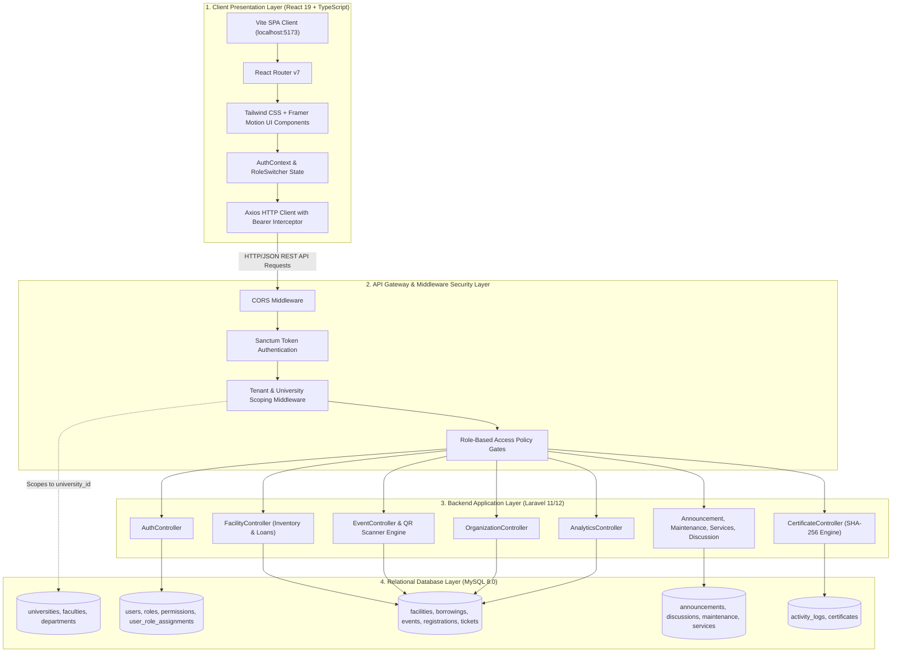
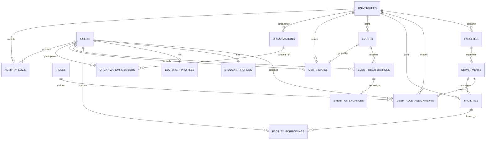
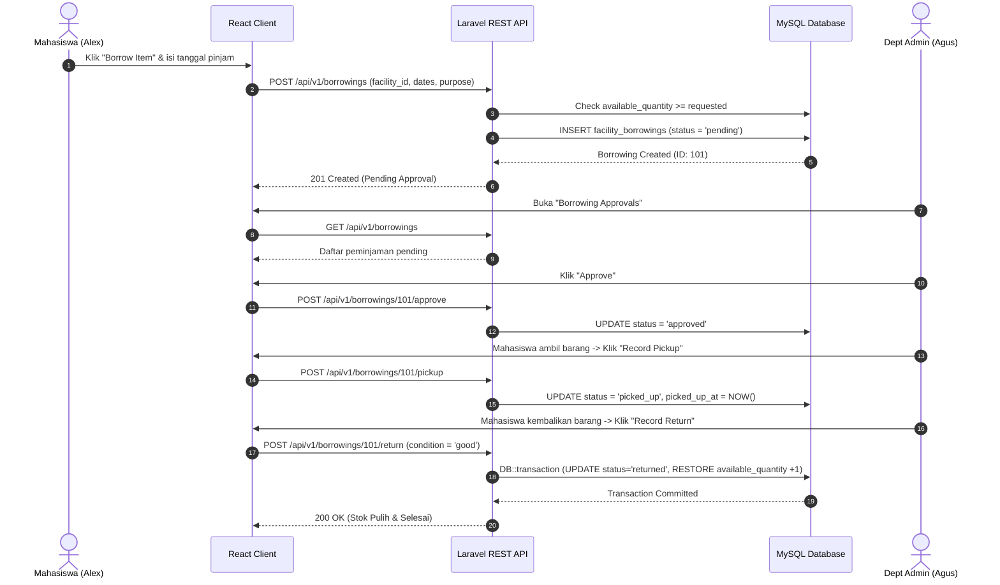

# CAMPUSCONNECT — SYSTEM ARCHITECTURE & TECHNICAL OVERVIEW
### Spesifikasi Desain Rekayasa Perangkat Lunak, Diagram Relasi, dan Mekanisme Multi-Tenant

> **Dokumen Teknis:** Software Architecture & System Engineering Manual  
> **Aplikasi:** CampusConnect Multi-University Integrated Platform  
> **Model Arsitektur:** Decoupled Client-Server (SPA + RESTful API) with Logical Tenant Partitioning  

---

## 1. Arsitektur Tingkat Tinggi (High-Level Architecture)

CampusConnect mengadopsi pola arsitektur **Decoupled Single Page Application (SPA)** yang berkomunikasi dengan **Laravel RESTful API** secara *stateless* menggunakan autentikasi token bearer **Laravel Sanctum**.



---

## 2. Mekanisme Multi-Tenant (Logical Tenant Isolation)

Sistem multi-tenant CampusConnect diimplementasikan menggunakan arsitektur **Shared Database with Logical Tenant Isolation**.

### Prinsip Kerja:
1. **Pemisahan Logis berbasis `university_id`:** Seluruh tabel operasional dan data institusi memiliki kolom foreign key `university_id` yang terindeks:
   - `faculties` & `departments`
   - `facilities` (alat inventaris lab) & `facility_borrowings` (peminjaman)
   - `events` & `event_registrations`
   - `organizations` & `work_programs`
   - `announcements` & `announcement_categories`
   - `maintenance_reports` (laporan kerusakan)
   - `service_requests` (surat aktif & transkrip)
   - `documents` (arsip pedoman kampus)
2. **Scoping Query Otomatis di Backend:**
   Ketika pengguna terautentikasi mengirimkan request, controller mengekstrak `active_assignment->university_id`. Query Eloquent secara ketat menyaring data:
   ```php
   $facilities = Facility::where('university_id', $activeUniversityId)->get();
   ```
3. **Pencegahan Eksploitasi Parameter:**
   Pengguna UIR tidak dapat menyuntikkan `university_id = 2` pada payload request untuk mengakses atau memanipulasi data ITN, karena backend memvalidasi hak akses penugasan (*assignment*) pengguna sebelum mengeksekusi operasi.
4. **Platform Core (Super Admin):**
   Super Admin memiliki peran platform-wide yang mengabaikan tenant filter pada modul pemantauan global, seperti persetujuan kampus baru dan audit logs sistem.

---

## 3. Diagram Relasi Entitas Utama (Database ERD Summary)

Basis data MySQL mencakup **44 tabel relasional**. Diagram berikut menggambarkan keterhubungan entitas inti:



---

## 4. Alur Komunikasi End-to-End (Workflow Sequence Diagrams)

### A. Alur Peminjaman Alat Lab (Equipment Borrowing State Machine)


---

### B. Alur Tiket QR Code & Validasi Anti-Duplikasi
```mermaid
sequenceDiagram
    autonumber
    actor Participant as Mahasiswa (Alex)
    participant Client as React Client
    participant API as Laravel Event Engine
    participant DB as MySQL Database
    actor Officer as Petugas Scanner

    Participant->>Client: Klik "Register Now" pada event
    Client->>API: POST /api/v1/events/{id}/register
    API->>DB: DB::transaction (lockForUpdate check quota)
    API->>DB: Generate Ticket Code TCK-XXXXXXXX & QR Token (SHA-256)
    DB-->>API: Ticket Registered
    API-->>Client: 201 Created + Ticket Data
    Client-->>Participant: Tampilkan Kartu Tiket & QR Code SVG

    Officer->>Client: Scan QR Code via Kamera / Input Manual
    Client->>API: POST /api/v1/events/verify-ticket (token: TCK-XXXXXXXX)
    API->>DB: SELECT registration WHERE ticket_code = token
    alt Belum Pernah Hadir (status == 'registered')
        API->>DB: UPDATE status = 'attended', checked_in_at = NOW()
        API->>DB: INSERT event_attendances
        API-->>Client: 200 OK (Check-In Confirmed - Hijau)
    else Sudah Pernah Hadir (status == 'attended')
        API-->>Client: 409 Conflict (DUPLICATE CHECK-IN PREVENTED - Merah)
    end
```

---

## 5. Keamanan & Integritas Data (Security Architecture)

1. **Otentikasi Aman (Bearer Tokens):**
   - Menggunakan token Sanctum dengan *hashed token storage* di tabel `personal_access_tokens`.
   - Token disimpan secara aman di browser client dan dikirim via header `Authorization: Bearer <token>`.
2. **Hashing Kata Sandi:**
   - Semua password di-hash menggunakan algoritma **Bcrypt** standar industri dengan *cost factor* 12.
3. **Pencegahan Concurrency Conflict (Race Conditions):**
   - Kuota pendaftaran event dan stok barang inventaris dilindungi dengan `DB::transaction()` dan penguncian baris pesimistik `lockForUpdate()`.
4. **Verifikasi Kriptografis Publik:**
   - Setiap e-sertifikat dilengkapi `verify_hash` unik yang di-generate dari gabungan nomor seri, ID penerima, dan timestamp menggunakan fungsi hash SHA-256:
     ```php
     $verifyHash = hash('sha256', $certNumber . '-' . $recipient->id . '-' . time());
     ```
   - Halaman publik `/verify/:hash` mencocokkan hash tersebut secara langsung ke database tanpa membuka celah data privat.
5. **Audit Logging Komprehensif:**
   - Seluruh aktivitas mutasi penting (login, persetujuan peminjaman, registrasi universitas, update password) dicatat otomatis di tabel `activity_logs` beserta metadata alamat IP (`$request->ip()`) dan User Agent klien.

---

*Spesifikasi Arsitektur Sistem CampusConnect v1.0.0 — Siap untuk Produksi dan Uji Sidang Akademik.*
